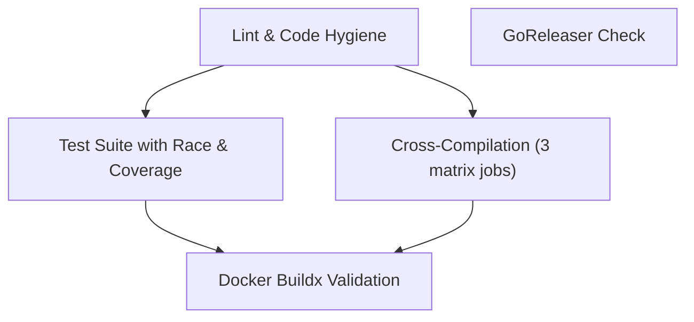

# gha-local-lint

**Offline GitHub Actions Expression Evaluator, Matrix Expander, & Pipeline Simulator**

[](https://github.com/smford/gha-local-lint/actions/workflows/ci.yml)
[](https://github.com/smford/gha-local-lint/actions/workflows/sast.yml)
[](https://github.com/smford/gha-local-lint/actions/workflows/scorecard.yml)
[](https://github.com/smford/gha-local-lint/actions/workflows/pre-commit.yml)
[](https://golang.org)
[](LICENSE)
[](Makefile)
[](https://sarifweb.azurewebsites.net/)

`gha-local-lint` is a fast, single-binary static analyzer, remediation tool, and dry-run execution simulator for GitHub Actions workflows (`.github/workflows/*.ya?ml`). It resolves matrix combinations, evaluates `${{ ... }}` conditional expressions against synthetic webhook payloads, detects DAG cycles and broken output references, catches security anti-patterns (script injection), and auto-fixes workflow issues offline before `git push`.

---

## The Problem

Engineers regularly burn dozens of `"fix ci"`, `"fix ci 2"`, `"debug matrix"` commits because standard YAML linters only check syntax. They do not:
1. **Evaluate expressions (`if:`)**: Typos like `if: matrix.os = 'ubuntu'` or broken `github.ref == 'refs/heads/main'` conditions pass syntax checks but break in production.
2. **Expand matrix permutations**: An unintended Cartesian product explosion (`os` × `node` × `db` × `redis` = 120 jobs) is only discovered after pushing.
3. **Verify job dependencies (`needs:`) & outputs**: References like `needs.build.outputs.artifact_id` fail silently or at runtime when the upstream job output is misnamed or not forwarded.
4. **Prevent script injection**: Untrusted inputs like `${{ github.event.pull_request.title }}` inside inline `run:` scripts introduce arbitrary command execution risks (OWASP CI/CD Top 10).

`gha-local-lint` gives you total offline visibility into your CI pipeline without needing GitHub runner tokens or pushing dummy commits.

---

## Features

- **Offline Expression Lexer & Evaluator**:
  - Deterministic recursive-descent parser for GitHub Actions `${{ ... }}` expressions.
  - Full operator support: `==`, `!=`, `<`, `<=`, `>`, `>=`, `&&`, `||`, `!`, parentheses `( )`, and property dereferencing (`.`, `['...']`).
  - GitHub Actions case-insensitivity semantics for context keys and string comparisons.
  - Built-in functions: `contains()`, `startsWith()`, `endsWith()`, `format()`, `join()`, `toJSON()`, `fromJSON()`, `hashFiles()`.
  - Status check functions: `success()`, `failure()`, `always()`, `cancelled()`, with automatic application of GHA's implicit `&& success()` rule.
- **Cartesian & Dynamic Matrix Expander**:
  - Models `strategy.matrix` with multi-dimensional Cartesian products.
  - Supports `include` (both key augmentation and new row insertion) and `exclude` filtering.
  - Supports dynamic matrix generation via `matrix: ${{ fromJSON(needs.setup.outputs.matrix) }}`.
  - Computes exact runner job counts and prints formatted ASCII tables or JSON.
- **DAG, Semantic, & Security Workflow Linting**:
  - Exact line and column numbers reported via `yaml.Node` AST.
  - Circular dependency detection in `needs:` chains (e.g. `job_a -> job_b -> job_a`).
  - Missing `needs:` targets and invalid output references (`needs.<job>.outputs.<key>` and `steps.<step>.outputs.<key>`).
  - Reusable workflow (`workflow_call`) validation: verifies caller passes required `inputs:` and target file exists.
  - Security checks: flags untrusted input injection inside `run:` blocks and scans for hardcoded secrets (GitHub PATs, AWS keys, Slack webhooks, private keys).
  - Deprecated runner detection: identifies retired or deprecated runners (`ubuntu-18.04`, `macos-11`, etc.) and recommends upgrades.
  - Best-practice rules: flags missing `timeout-minutes`, unpinned third-party actions, and `permissions: write-all`.
  - Configurable rules & exclusions via `.gha-lint.yaml`.
- **Runner Cost & Quota Estimator (`cost`)**:
  - Estimates total runner-minutes and projected monthly dollar spend across Linux, macOS, and Windows runners.
  - Accounts for multi-dimensional matrix multiplications and custom job `timeout-minutes`.
- **Automated Remediation (`--fix`)**:
  - Auto-fixes script injections by extracting untrusted expressions into intermediate `env:` variables.
  - Auto-pins known popular actions (e.g. `actions/checkout@v4`) to immutable 40-character commit SHAs.
  - Auto-injects missing job `timeout-minutes: 60` with exact whitespace indentation.
  - Auto-injects missing workflow top-level `permissions: contents: read` blocks.
  - Auto-upgrades retired and deprecated runner labels (`ubuntu-18.04`, `ubuntu-20.04`, `macos-11`).
  - Auto-resolves invalid self-referencing job outputs (`needs.<this_job>.outputs` -> `steps.<step>.outputs`).
- **SARIF 2.1.0 & Pre-Commit Hook**:
  - Exports standard SARIF format for integration with GitHub Code Scanning (`upload-sarif`).
  - Includes `.pre-commit-hooks.yaml` for pre-commit git workflows.
  - Includes `extension.yml` for GitHub CLI extension (`gh gha-lint`).
- **Dry-Run Simulation**:
  - Evaluates workflow triggers (`push`, `pull_request`, `release`, `workflow_dispatch`, `branches`, `paths`).
  - Git diff integration: evaluate `paths:` filters against actual local git changes (`--diff-against` or `--detect-changes`).
  - Mock job outputs with `--mock-output setup.matrix='[...]'`.
  - Interactive terminal mode (`--interactive`) for on-the-fly event toggling.
  - Visual tree display showing which jobs and steps **WILL RUN** vs **SKIPPED** (with exact reasons).
  - Interactive standalone HTML report export (`--format=html`) with offline dark mode and live search/filter.
  - Simulate failure scenarios using `--fail-job <job_id>` to verify fallback and notification logic (`if: failure()` / `if: always()`).

---

## Installation

### Via Homebrew (macOS & Linux)

Install using the official Homebrew tap:

```bash
# Tap repository and install
brew tap smford/tap
brew install gha-local-lint

# Or one-line install
brew install smford/tap/gha-local-lint
```

### From Source (Go 1.23+)

```bash
# Clone the repository
git clone https://github.com/smford/gha-local-lint.git
cd gha-local-lint

# Build standalone binary (Zero-CGO)
make build

# Or install to $GOPATH/bin
make install
```

### Pre-commit Integration

Add this to your `.pre-commit-config.yaml`:

```yaml
repos:
  - repo: https://github.com/smford/gha-local-lint
    rev: v0.4.0
    hooks:
      - id: gha-local-lint
```

### GitHub Action Integration

Run `gha-local-lint` directly in any GitHub Actions workflow via [`action.yml`](action.yml):

```yaml
- name: Lint Workflow Files
  uses: smford/gha-local-lint@v0.4.0
  with:
    require-sha-pin: true
    format: text
```

---

## Quick Start & CLI Usage

### 1. `check` — Semantic & Security Linting

Validate workflow files for DAG cycles, broken outputs, unpinned actions, and script injection:

```bash
# Lint default workflows in .github/workflows/*.yml
gha-local-lint check

# Auto-fix unpinned actions, script injections, missing timeouts, and permissions!
gha-local-lint check --fix .github/workflows/*.yml

# Enforce 40-character SHA pinning for third-party actions
gha-local-lint check --require-sha-pin .github/workflows/*.yml

# Use repository configuration (.gha-lint.yaml)
gha-local-lint check --config .gha-lint.yaml .github/workflows/*.yml

# Export SARIF for GitHub Code Scanning
gha-local-lint check --format sarif .github/workflows/*.yml > results.sarif

# Output machine-readable JSON
gha-local-lint check --format json .github/workflows/*.yml
```

---

### 2. `simulate` — Dry-Run Execution Planner

Simulate how GitHub Actions evaluates conditional expressions, trigger filters, and job dependencies:

```bash
# Simulate a push to main
gha-local-lint simulate .github/workflows/release.yml --event push --ref refs/heads/main

# Simulate a pull request
gha-local-lint simulate .github/workflows/release.yml --event pull_request --ref refs/heads/feature/auth

# Simulate with local git modified files (checks paths: and paths-ignore:)
gha-local-lint simulate .github/workflows/ci.yml --detect-changes
gha-local-lint simulate .github/workflows/ci.yml --diff-against origin/main

# Simulate with mock outputs (e.g. dynamic matrix from an upstream job)
gha-local-lint simulate .github/workflows/ci.yml --mock-output setup.targets='["api", "worker"]'

# Simulate with a specific job failing to verify notification steps
gha-local-lint simulate .github/workflows/release.yml --event push --fail-job test

# Launch interactive simulation explorer
gha-local-lint simulate .github/workflows/release.yml --interactive

# Generate standalone offline HTML simulation report
gha-local-lint simulate .github/workflows/release.yml --format html > simulation_report.html
```

**Example Output:**
```text
======================================================================
 WORKFLOW SIMULATION: Production Release Pipeline (.github/workflows/release.yml)
======================================================================
  Trigger: triggered by event "pull_request" on ref "refs/heads/main"

[WILL RUN] Job: test [go: 1.22, os: ubuntu-latest]
      ✓ [WILL RUN] Checkout Code
      ✓ [WILL RUN] Setup Go
      ✓ [WILL RUN] Run Tests
      - [SKIPPED]  Upload Coverage
                   (reason: condition 'matrix.coverage == true' evaluated to false)

[WILL RUN] Job: test [coverage: true, go: 1.23, os: ubuntu-latest]
      ✓ [WILL RUN] Checkout Code
      ✓ [WILL RUN] Setup Go
      ✓ [WILL RUN] Run Tests
      ✓ [WILL RUN] Upload Coverage

[WILL RUN] Job: build
      ✓ [WILL RUN] Checkout
      ✓ [WILL RUN] Compile Binary

[SKIPPED]  Job: deploy
         Reason: condition 'github.event_name == 'push' && github.ref == 'refs/heads/main'' evaluated to false
```

---

### 3. `matrix` — Inspect Matrix Expansions

Inspect matrix permutations before triggering accidental runner quota spikes:

```bash
# Show matrix table for all jobs
gha-local-lint matrix .github/workflows/release.yml

# Filter by specific job
gha-local-lint matrix .github/workflows/release.yml --job test

# Output JSON
gha-local-lint matrix .github/workflows/release.yml --format json
```

**Example Output:**
```text
Job: test (defined as "Unit & Integration Tests")
#   | coverage | go   | os
----+----------+------+--------------
1   | <nil>    | 1.22 | ubuntu-latest
2   | <nil>    | 1.22 | macos-latest
3   | true     | 1.23 | ubuntu-latest
4   | <nil>    | 1.23 | macos-latest

Total combinations: 4

Grand Total Runner Jobs Across Evaluated Targets: 5
```

---

### 4. `cost` — Runner Cost & Quota Estimator

Estimate compute minutes and billing costs across Linux, Windows, and macOS runners (accounting for matrix permutations and job timeouts):

```bash
# Estimate runner minutes and monthly budget across workflows
gha-local-lint cost .github/workflows/*.yml

# Customize estimated average job duration and monthly run volume
gha-local-lint cost --duration 15 --runs-per-month 250 .github/workflows/ci.yml

# Output machine-readable JSON for CI budgeting alerts
gha-local-lint cost --format json .github/workflows/ci.yml
```

**Example Output:**
```text
======================================================================
 RUNNER COST & QUOTA ESTIMATE: CI & Release Pipeline
======================================================================
Workflow: .github/workflows/ci.yml
Total Runner Jobs per Run: 5 (Linux: 3, macOS: 1, Windows: 1)
Estimated Compute per Run: 50 runner-minutes (~$0.1040/run)
Monthly Estimate (100 runs): 5000 runner-minutes (~$10.40/month)

Job ID               | OS       | Runners      | Est. Mins    | Cost / Month
---------------------+----------+--------------+--------------+----------------
lint                 | linux    | 1            | 10           | $8.00
test                 | linux    | 2            | 20           | $16.00
cross-compile        | macos    | 1            | 10           | $64.00
windows-build        | windows  | 1            | 10           | $16.00
```

---

### 5. `graph` — Export Visual Pipeline DAGs

Export job dependencies as Mermaid.js or Graphviz DOT flowcharts to embed in pull requests or architecture documentation:

```bash
# Export Mermaid diagram (compatible with GitHub Markdown)
gha-local-lint graph .github/workflows/ci.yml --format=mermaid

# Export Graphviz DOT format
gha-local-lint graph .github/workflows/ci.yml --format=dot
```

**Example Mermaid Output:**


---

### 6. `expr` — Expression Evaluator & Interactive REPL

Evaluate GitHub Actions expressions directly on the command line or launch an interactive REPL session:

```bash
# One-shot expression evaluation
gha-local-lint expr "contains('refs/heads/main', 'main') && !false"

# Evaluate with mock context JSON
gha-local-lint expr --context '{"github":{"actor":"octocat"}}' "github.actor == 'OCTOCAT'"

# Launch interactive REPL
gha-local-lint expr --interactive
```

---

### 7. `completion` — Shell Autocompletion

Generate fast autocompletion scripts for your shell:

```bash
# Zsh
source <(gha-local-lint completion zsh)

# Bash
source <(gha-local-lint completion bash)

# Fish
gha-local-lint completion fish | source
```

---

### 8. `version` — Inspect Version, License, & Links

Inspect the compiled release version, commit hash, build date, license, and repository links:

```bash
# Human-readable version information
gha-local-lint version

# Or structured JSON for tooling
gha-local-lint version --format=json
```

**Example Output:**
```text
gha-local-lint v0.4.0
  Commit:  3436034
  Date:    2026-10-22T13:35:30Z
  License: MIT License
  Repo:    https://github.com/smford/gha-local-lint
  Docs:    https://smford.github.io/gha-local-lint
```

---

## Performance Benchmarks

Built with Zero-CGO and optimized recursive-descent parsing:

| Operation | Throughput | Latency | Allocations |
| :--- | :--- | :--- | :--- |
| **Expression Lexer** | ~1,630,000 ops/sec | 780 ns/op | 17 allocs/op |
| **Expression Parser** | ~1,470,000 ops/sec | 707 ns/op | 33 allocs/op |
| **Condition Evaluation** | ~830,000 ops/sec | 1.4 µs/op | 60 allocs/op |
| **Dynamic Matrix Expansion** | ~4,700,000 ops/sec | 312 ns/op | 13 allocs/op |

Run benchmarks locally:
```bash
make bench
```

---

## Repository Configuration (`.gha-lint.yaml`)

You can customize rules, severities, exclusions, and simulation defaults in a `.gha-lint.yaml` (or `.gha-lint.yml`) file at your repository root:

```yaml
version: 1

# Exclude legacy or third-party workflows from validation
exclude:
  - ".github/workflows/archive/**"
  - ".github/workflows/vendor-*.yml"

# Rule severity overrides: off | info | warning | error
rules:
  hardcoded-secrets: error
  deprecated-runner: error
  unpinned-action: error
  missing-timeout-minutes: warning
  broad-permissions: warning

# Default flags for simulation runs
simulate:
  default-ref: "refs/heads/main"
  default-event: "pull_request"
```

---

## Automated Remediation Philosophy (`--fix`)

Like modern linters (`eslint --fix`, `golangci-lint --fix`), `gha-local-lint` adheres to a strict safety model:
> **Automated fixes must be deterministic and safe.** If remediating an issue requires architectural choice or guessing developer intent, the tool reports the issue with exact line/column coordinates for human review instead of making risky assumptions that could break production pipelines.

### What `--fix` Automatically Remediates

| Rule | Remediation Applied |
| :--- | :--- |
| `missing-timeout-minutes` | Injects `timeout-minutes: 60` with exact whitespace indentation matching existing job keys. |
| `missing-workflow-permissions` | Injects least-privilege top-level `permissions:\n  contents: read` directly above `jobs:`. |
| `deprecated-runner` | Upgrades retired/deprecated runner labels (e.g. `ubuntu-18.04`/`20.04` → `ubuntu-22.04`, `macos-11` → `macos-13`, `windows-2016` → `windows-2022`). |
| `script-injection` | Rewrites vulnerable inline `${{ github.event... }}` into safe intermediate `env:` variables (`INPUT_...`). |
| `unpinned-action` *(Known)* | Pins popular actions (`actions/checkout@v4`, `setup-go@v5`, `cache@v4`, etc.) to immutable 40-character commit SHAs. |
| `invalid-needs-reference` *(Self)* | Rewrites self-referencing `${{ needs.<this_job>.outputs.<key> }}` to the underlying `${{ steps.<step>.outputs.<key> }}`. |

### Why Some Rules Require Manual Review (Not Auto-Fixed)

For semantic and architectural issues, automated guessing could introduce security vulnerabilities, race conditions, or silent deployment failures:

| Rule | Why Automated Fixing is Intentionally Avoided |
| :--- | :--- |
| `hardcoded-secrets` | An automated tool cannot determine your configured repository secret names in GitHub Settings (e.g. `${{ secrets.PROD_AWS_KEY }}` vs `${{ secrets.DEV_AWS_KEY }}`). Exposed credentials must also be revoked immediately in the cloud provider. |
| `dag-circular-dependency` | In circular dependencies (`A ⇄ B`), choosing which dependency edge to sever is an architectural pipeline design decision. |
| `dag-missing-need` | Deleting a missing upstream job from `needs: [...]` could trigger deployments prematurely before prerequisite build or test stages complete. |
| `invalid-job-output-reference` | If `needs.build.outputs.artifact_id` is undeclared, guessing whether the upstream job omitted the output or whether there is a typo requires human verification. |
| `invalid-step-reference` | If `steps.build_step.outputs.id` does not exist, only the pipeline author knows which step produces the required payload. |
| `missing-reusable-workflow` | Missing reusable workflow files cannot be synthesized out of thin air. |
| `missing-required-workflow-input` | Mandatory parameters without defaults require explicit caller values. |
| `shell-syntax` | Arbitrary bash syntax errors (e.g. unmatched quotes, unclosed `if`/`fi`) require human coding to preserve script logic. |

---

## Rules Reference

| Rule | Default Severity | Auto-Fixable? | Description |
| :--- | :--- | :--- | :--- |
| `dag-circular-dependency` | **ERROR** | Manual | Detects cycles in job `needs:` dependencies (e.g. `A -> B -> A`). |
| `dag-missing-need` | **ERROR** | Manual | Job references an upstream job in `needs:` that does not exist. |
| `invalid-job-output-reference` | **ERROR** | Manual | `needs.<job>.outputs.<name>` references an output not declared in upstream job's `outputs:` block. |
| `invalid-step-reference` | **ERROR** | Manual | `steps.<step_id>.outputs.<name>` references a non-existent step ID in the same job. |
| `invalid-needs-reference` | **ERROR** | ✓ Partial (Self-references) | Flags invalid `needs` expressions, auto-resolving inner self-references to step outputs. |
| `missing-reusable-workflow` | **ERROR** | Manual | Caller references a reusable workflow file that does not exist. |
| `missing-required-workflow-input` | **ERROR** | Manual | Reusable workflow call is missing required `with:` input parameters. |
| `script-injection` | **ERROR** | ✓ Yes | Untrusted context (`github.event.pull_request.title`, `head_ref`, etc.) directly interpolated in inline `run:` script. |
| `shell-syntax` | **ERROR** | Manual | Shell syntax error detected inside an inline `run:` block. |
| `hardcoded-secrets` | **ERROR** | Manual | Plaintext GitHub PATs (`ghp_`, `github_pat_`), AWS credentials, Slack webhooks, or private keys detected in workflow files. |
| `deprecated-runner` | **WARNING** / **ERROR** | ✓ Yes | Identifies retired or deprecated GitHub runners (`ubuntu-18.04`, `ubuntu-20.04`, `macos-11`, etc.) and recommends current upgrades. |
| `unpinned-action` | **WARNING** (ERROR with `--require-sha-pin`) | ✓ Partial (Known actions) | Third-party action is not pinned to a 40-character commit SHA. |
| `missing-workflow-permissions` | **WARNING** | ✓ Yes | Workflow lacks a top-level `permissions:` block. |
| `broad-permissions` | **WARNING** | Manual | Workflow or job defines overly permissive `permissions: write-all`. |
| `missing-timeout-minutes` | **WARNING** | ✓ Yes | Job is missing `timeout-minutes`, exposing runners to hung tasks. |

---

## Development & Testing

Run all unit tests with race detection:

```bash
make test
```

Build the release binary:

```bash
make build
```

Run test suite against sample workflows:

```bash
make lint-self
```

---

## License

MIT License. See [LICENSE](LICENSE) for details.
